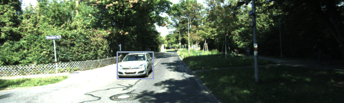

# CurbScope

How much curb can you park on, how much of it is taken, and when did each car arrive?
CurbScope answers this per 20 m curb segment from public KITTI driving data (camera, LiDAR,
GPS/IMU), and reads Edmonton parking signs into machine-readable time rules. Every number is
checked against hand-made labels.



*Frames from KITTI raw drive 2011_09_26_drive_0022 (Geiger et al., CC BY-NC-SA 3.0) with
CurbScope's track IDs drawn on top; the GIF is shared under the same licence.*

## Run it

Needs WSL2 Ubuntu (or Linux), `make` and [uv](https://docs.astral.sh/uv/).
uv downloads Python 3.11 itself.

```bash
make setup                                  # pinned dependencies into ~/.venvs/curbscope
make test                                   # unit tests, no KITTI data needed
make info DRIVE=2011_09_26_drive_0022       # needs a downloaded drive, see below
make track                                  # YOLO + ByteTrack on every drive in configs/default.yaml
```

`make track` first downloads the YOLO weights (about 5 MB) and checks their SHA-256 against
the config. Tracking itself runs offline. Outputs: `results/tracks_<drive>.csv` (one row per
tracked box), `results/tracks_summary.json` and the demo GIF above.

KITTI needs a free login, so the data is not downloaded by a script:
see [docs/download_kitti.md](docs/download_kitti.md). Data goes to `~/data/kitti` by default;
use `make info KITTI_DIR=/other/path DRIVE=...` to point elsewhere.

## How it works

- [M0: loading a KITTI drive](docs/how_it_works_m0.md)
- [M1: detecting and tracking vehicles](docs/how_it_works_m1.md)

## Data and licences

| Source | Used for | Licence |
| --- | --- | --- |
| [KITTI raw](https://www.cvlibs.net/datasets/kitti/raw_data.php) | camera, LiDAR, GPS/IMU, 3D tracklets | CC BY-NC-SA 3.0, non-commercial |
| [pykitti](https://github.com/utiasSTARS/pykitti) | reading KITTI raw files | MIT |
| [Ultralytics](https://github.com/ultralytics/ultralytics) 8.4.196 and YOLO11n COCO weights | detection, ByteTrack tracking | AGPL-3.0 |
| [PyTorch](https://pytorch.org) (CPU build) | running YOLO | BSD-3-Clause and others (see its licence) |
| [lap](https://github.com/gatagat/lap) | ByteTrack's assignment step | BSD-2-Clause |
| [OpenCV](https://opencv.org) | drawing boxes, resizing | Apache-2.0 |

Because Ultralytics is AGPL-3.0, this repository is open source under the same licence.
No KITTI files, photos or model weights are stored in this repository.

## Limitations

- KITTI was recorded in Karlsruhe, Germany. Edmonton parking rules are applied only as a
  demonstration configuration, not as a legal judgement about German streets.
- Detection uses COCO weights without fine-tuning; COCO has no class for driveways or parking
  signs. Tracked boxes are ByteTrack's smoothed boxes, and a car can get a new ID after a
  long occlusion; such ID switches are kept as they are.
