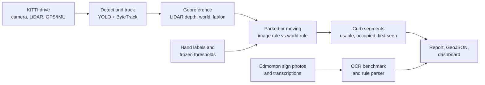
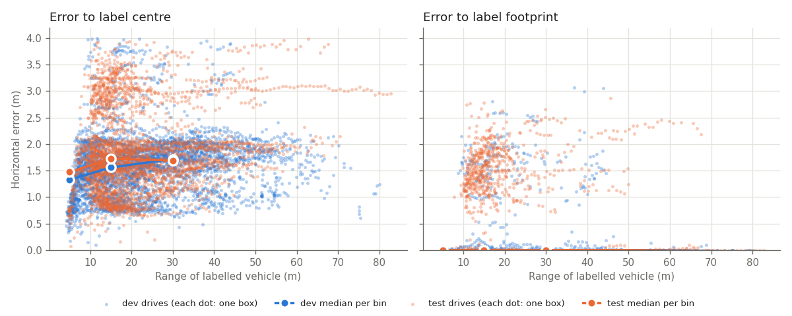

# CurbScope

How much curb can you park on, how much of it is taken, and when did each car arrive?
CurbScope answers this per 20 m curb segment from public KITTI driving data (camera, LiDAR,
GPS/IMU), and reads Edmonton parking signs into machine-readable time rules. Every number is
checked against hand-made labels or KITTI's own 3D labels.


*Frames from KITTI raw drive 2011_09_26_drive_0022 (Geiger et al., CC BY-NC-SA 3.0) with
CurbScope's track IDs drawn on top; the GIF is shared under the same licence.*

## The problem

From a moving car, a parked car also moves in the image. CurbScope therefore puts every
detected vehicle into world coordinates with LiDAR depth and the GPS/IMU pose: a parked car is
one whose world position does not change. Parked cars are then measured along the curb, minus
the no-parking zones around fire hydrants and stop signs.



## Results

Generated by `make report` from `results/`; nothing below is typed by hand.

<!-- results:start -->
### Position against KITTI's 3D labels

| Drive | Split | Matched boxes | Error to centre, median / p90 (m) | Error to footprint, median / p90 (m) | Boxes without position |
| --- | --- | --- | --- | --- | --- |
| 0022 | dev | 1893 | 1.70 / 2.10 | 0.00 / 0.00 | 320 / 2791 |
| 0036 | dev | 1816 | 1.49 / 2.14 | 0.00 / 0.00 | 933 / 3912 |
| 0023 | test | 3091 | 1.74 / 3.06 | 0.00 / 1.51 | 613 / 5327 |

Median error to the label centre by range (matched boxes in brackets):

| Drive | 0-10 m | 10-20 m | 20-40 m | 40+ m |
| --- | --- | --- | --- | --- |
| 0022 | 1.43 (370) | 1.62 (609) | 1.77 (709) | 1.89 (205) |
| 0036 | 1.11 (224) | 1.48 (550) | 1.59 (725) | 1.61 (317) |
| 0023 | 1.47 (193) | 1.73 (1513) | 1.69 (1062) | 1.99 (323) |

LiDAR sees the near side of a car while the label sits at its centre, so the error to the centre includes up to half a car length by construction; the error to the footprint is 0 when the point lies on the labelled car.

### Parked or moving

Pending: needs the owner's track labels (`make label`) and the frozen thresholds in `configs/frozen_thresholds.yaml` (`make tune`, then `make evaluate SPLIT=test`).

### Curb segments

Pending: needs `configs/frozen_thresholds.yaml` (see parked or moving), then `make segments`.

### Edmonton parking sign OCR

Pending: needs the owner's Edmonton sign photos, their transcriptions in `labels/signs_groundtruth.csv` and the Tesseract program, then `make strip-exif ocr`.

Full tables: [results/report.md](results/report.md).
<!-- results:end -->



## Run it

Needs WSL2 Ubuntu (or Linux), `make` and [uv](https://docs.astral.sh/uv/).
uv downloads Python 3.11 itself.

```bash
make setup                                  # pinned dependencies into ~/.venvs/curbscope
make test                                   # unit tests, no KITTI data needed
make all                                    # every pipeline step whose inputs exist, then the report
```

Step by step:

```bash
make info DRIVE=2011_09_26_drive_0022       # frames, duration, distance of one drive
make track                                  # YOLO + ByteTrack on every drive in configs/default.yaml
make geo                                    # LiDAR position, lat/lon, error against KITTI labels
make motion                                 # per-track features for the parked/moving rules
make label                                  # labelling page in the browser
make tune                                   # rule accuracy over thresholds, dev drives only
make evaluate SPLIT=test                    # needs the committed configs/frozen_thresholds.yaml
make segments                               # curb segments and GeoJSON for QGIS
make strip-exif                             # sign photos copied without EXIF metadata
make ocr                                    # Tesseract vs EasyOCR vs TrOCR on the signs
make report                                 # results/report.md and the results above
make dashboard                              # Streamlit dashboard
```

KITTI needs a free login, so the data is not downloaded by a script:
see [docs/download_kitti.md](docs/download_kitti.md). Data goes to `~/data/kitti` by default;
pass `KITTI_DIR=/other/path` to point elsewhere. `make track` downloads the YOLO weights (about
5 MB) and checks their SHA-256; tracking itself runs offline. `make ocr` needs the Tesseract
program (`sudo apt install tesseract-ocr`) and downloads the EasyOCR (about 100 MB) and TrOCR
(about 1.3 GB) models on first use.

Steps that need human input stop with a message until it exists: track labels and frozen
thresholds for parked or moving and for curb segments, sign photos and transcriptions for OCR.

## How it works

- [Architecture and decisions](docs/ARCHITECTURE.md)
- [M0: loading a KITTI drive](docs/how_it_works_m0.md)
- [M1: detecting and tracking vehicles](docs/how_it_works_m1.md)
- [M2: putting every box on the map](docs/how_it_works_m2.md)
- [M3: parked or moving](docs/how_it_works_m3.md)
- [M4: curb segments](docs/how_it_works_m4.md)
- [M5: reading parking signs](docs/how_it_works_m5.md)
- [M6: report and dashboard](docs/how_it_works_m6.md)

## Data and licences

| Source | Used for | Licence |
| --- | --- | --- |
| [KITTI raw](https://www.cvlibs.net/datasets/kitti/raw_data.php) | camera, LiDAR, GPS/IMU, 3D tracklets | CC BY-NC-SA 3.0, non-commercial |
| [pykitti](https://github.com/utiasSTARS/pykitti) | reading KITTI raw files | MIT |
| [Ultralytics](https://github.com/ultralytics/ultralytics) 8.4.196 and YOLO11n COCO weights | detection, ByteTrack tracking | AGPL-3.0 |
| [PyTorch](https://pytorch.org) (CPU build) | running YOLO | BSD-3-Clause and others (see its licence) |
| [lap](https://github.com/gatagat/lap) | ByteTrack's assignment step | BSD-2-Clause |
| [OpenCV](https://opencv.org) | drawing boxes, resizing | Apache-2.0 |
| [pyproj](https://github.com/pyproj4/pyproj) | world coordinates to latitude, longitude | MIT |
| [SciPy](https://scipy.org) | Hungarian matching against labels | BSD-3-Clause |
| [Streamlit](https://streamlit.io) | labelling page and dashboard | Apache-2.0 |
| [Shapely](https://github.com/shapely/shapely) | path geometry for curb segments | BSD-3-Clause |
| [Folium](https://github.com/python-visualization/folium) and streamlit-folium | dashboard map | MIT |
| [EasyOCR](https://github.com/JaidedAI/EasyOCR) 1.7.2 | text detection and one recogniser | Apache-2.0 |
| [Tesseract](https://github.com/tesseract-ocr/tesseract) via pytesseract | recogniser | Apache-2.0 |
| [TrOCR](https://huggingface.co/microsoft/trocr-base-printed) base-printed via Transformers | recogniser | MIT (microsoft/unilm repository; the model card states none) |
| [jiwer](https://github.com/jitsi/jiwer) | character error rate | Apache-2.0 |
| [OpenStreetMap](https://www.openstreetmap.org/copyright) | dashboard base map | ODbL, © OpenStreetMap contributors |

Because Ultralytics is AGPL-3.0, this repository is open source under the same licence
([LICENSE](LICENSE)).
No KITTI files, photos or model weights are stored in this repository. Images in `results/` that
show KITTI frames (the demo GIF and `geo_check_*.png`) are shared under KITTI's CC BY-NC-SA 3.0.
Edmonton parking rules and their sources are in `configs/rules_edmonton.yaml`.

## Limitations

- KITTI was recorded in Karlsruhe, Germany. Edmonton parking rules are applied only as a
  demonstration configuration, not as a legal judgement about German streets.
- Three drives, a few hundred tracks and a few dozen signs: the results describe these samples,
  not general performance.
- Detection uses COCO weights without fine-tuning; COCO has no class for driveways or parking
  signs. Tracked boxes are ByteTrack's smoothed boxes, and a car can get a new ID after a
  long occlusion; such ID switches are kept as they are.
- Positions come from the LiDAR points on the side of a car that faces the sensor, so they sit
  up to half a car length from the car's centre. Boxes with fewer than 10 LiDAR points (mostly
  distant or occluded cars) get no position and are counted as unknown. Ground points are
  removed with a flat-road assumption, and KITTI's scans are not motion-compensated.
- No-parking zones are subtracted only around detected fire hydrants and stop signs. COCO has
  no class for driveways, intersections or crosswalks, so those Edmonton rules are not applied.
  A vehicle's length along the curb falls back to 4.5 m when LiDAR cannot measure it; the
  summary counts how often.
- Sign reading keeps only the first time range on a sign and produces one rule per photo; the
  sign photos are Edmonton's, while the curb measurements are from Karlsruhe.
- No GNSS correction (RTK/NTRIP) and no point-cloud semantic segmentation: ground removal is a
  height threshold.

## Next steps

- Road grade and sight distance from the LiDAR ground plane.
- A parking-sign detector fine-tuned on the Edmonton photos.
- Stereo depth in place of LiDAR, for camera-only data.
